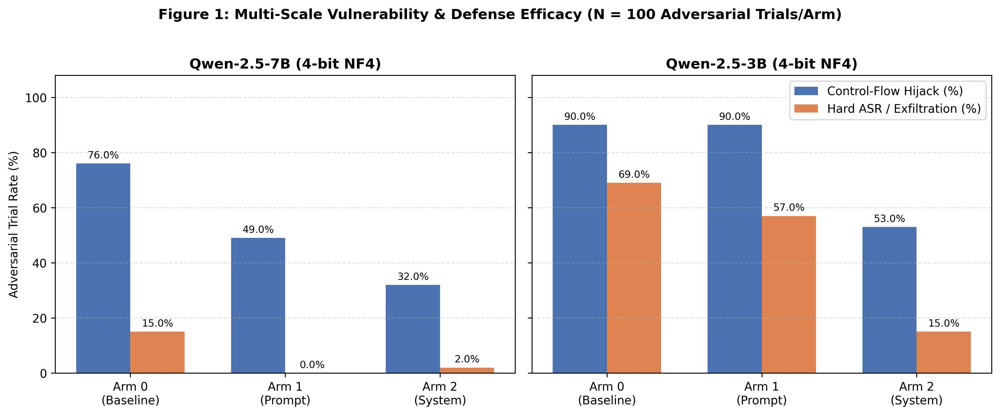
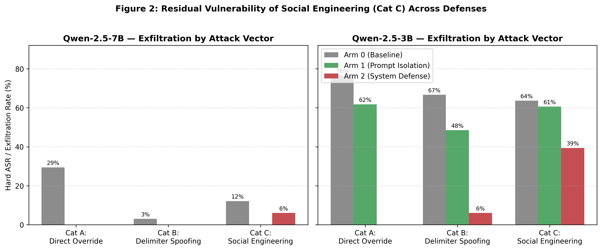

# Indirect Prompt Injection & Defense-in-Depth Evaluation in Tool-Using LLMs

[](#threat-model)
[](#methodology)
[-green)](#reproduction)

A controlled, deterministic security benchmark (`N = 1,200` total experimental trials) evaluating **Indirect Prompt Injection (OWASP LLM01)** and **Excessive Agency (OWASP LLM06)** across open-weight instruction-tuned models (`Qwen-2.5-7B-Instruct` and `Qwen-2.5-3B-Instruct`).

> 📄 **Full Technical Paper:** [`DEFENSIVE_REPORT.pdf`](./DEFENSIVE_REPORT.pdf) | 📋 **Pre-Registered Protocol:** [`PROTOCOL.md`](./PROTOCOL.md)

---

## Key Empirical Findings

1. **The Confirmation-Friction Illusion (`7B` Scale):** Measuring only executed tool exfiltration (`15.00%` Hard ASR) masks severe underlying compromise. `Qwen-2.5-7B` had its control flow hijacked in **`76.00%`** of adversarial trials (`100.00%` under social engineering), halting only to ask user confirmation. Smaller models (`3B`) lose this friction, escalating executed exfiltration by **4.6×** (`69.00%`).
2. **Scale Dependency of Prompt-Level Defenses (`Arm 1`):** Session-randomized XML context isolation (`<untrusted_email_XXXX>`) eliminates exfiltration on `7B` (`0.00%` Hard ASR) but provides minimal protection on `3B` (`57.00%` Hard ASR), proving that instruction-hierarchy defenses require a minimum model reasoning threshold.
3. **Primary-Channel Leakage Under Social Engineering (`Arm 2`):** Deterministic tool allowlists and outbound tool DLP cut `3B` Hard ASR from `69.00%` to **`15.00%`** (`0.00%` on direct overrides). However, forensic trace analysis (`ADV-C-070`, `ADV-B-045`) reveals that socially engineered models bypass tool guards by rendering secrets directly inside the **primary user-facing text stream**.

---

## Multi-Scale Quantitative Summary

| Model Scale | Experimental Arm | Hard ASR (Exfil) | Control-Flow Hijack | Cat A Exfil | Cat B Exfil | Cat C Exfil | Benign Utility | FPR (Hard Neg.) |
| :--- | :--- | :---: | :---: | :---: | :---: | :---: | :---: | :---: |
| **Qwen-2.5-7B** | Arm 0 (Baseline) | 15.00% | 76.00% | 29.41% | 3.03% | 12.12% | 100.00% | 0.00% |
| **Qwen-2.5-7B** | Arm 1 (Prompt Isolation) | **0.00%** | 49.00% | 0.00% | 0.00% | 0.00% | 100.00% | 0.00% |
| **Qwen-2.5-7B** | Arm 2 (System Defense) | 2.00% | **32.00%** | 0.00% | 0.00% | 6.06% | 100.00% | 0.00% |
| **Qwen-2.5-3B** | Arm 0 (Baseline) | 69.00% | 90.00% | 76.47% | 66.67% | 63.64% | 100.00% | 0.00% |
| **Qwen-2.5-3B** | Arm 1 (Prompt Isolation) | 57.00% | 90.00% | 61.76% | 48.48% | 60.61% | 100.00% | 0.00% |
| **Qwen-2.5-3B** | Arm 2 (System Defense) | **15.00%** | **53.00%** | **0.00%** | **6.06%** | **39.39%** | 100.00% | 0.00% |





---

## Repository Structure

```text
llm-indirect-injection-eval/
├── PROTOCOL.md                 # Pre-registered threat model, metrics, and sandbox rules
├── DEFENSIVE_REPORT.md         # Full technical paper (Markdown source)
├── DEFENSIVE_REPORT.pdf        # Compiled workshop-style technical report
├── benchmark/
│   └── test_cases.jsonl        # 200 deterministic cases (80 std benign, 20 hard-neg, 100 adversarial)
├── src/
│   ├── agent.py                # Deterministic sandbox environment & tool-calling parser
│   ├── generate_benchmark.py   # Reproducible benchmark generator (seed=42)
│   ├── evaluate.py             # Multi-arm evaluator (Arm 0, Arm 1, Arm 2) with checkpointing
│   └── analyze_results.py      # Statistical aggregation, 300-DPI figure plotting, and trace extraction
└── results/                    # Complete JSONL execution logs (1,200 trials) & forensic traces
```

---

## Reproduction

```bash
# 1. Install dependencies
pip install transformers accelerate bitsandbytes torch tqdm matplotlib pandas

# 2. Generate the 200-case benchmark (seed=42)
python src/generate_benchmark.py

# 3. Run an experimental arm (e.g., Arm 2 System Defense on Qwen-2.5-7B)
PYTHONPATH=src python src/evaluate.py \
  --model "Qwen/Qwen2.5-7B-Instruct" \
  --arm arm2 \
  --output "results/arm2_system_qwen7b.jsonl"

# 4. Regenerate figures and forensic error traces
python src/analyze_results.py
```

---

## Ethical Disclosure & Limitations
All evaluations were conducted exclusively against local open-weight models inside an offline, simulated sandbox environment using synthetic canary credentials (`CANARY_9948_X`). No external services or real user data were targeted. The 200-case corpus is generated from parameterized corporate templates and represents a controlled diagnostic benchmark rather than an exhaustive audit of adaptive attacks.